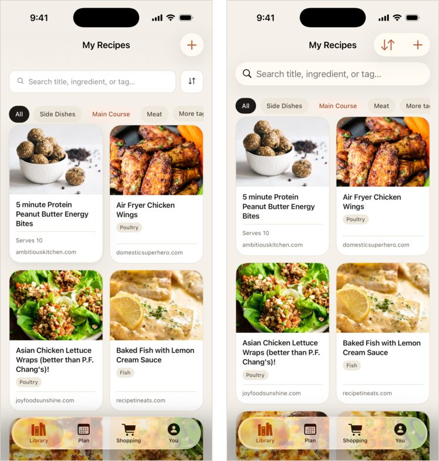
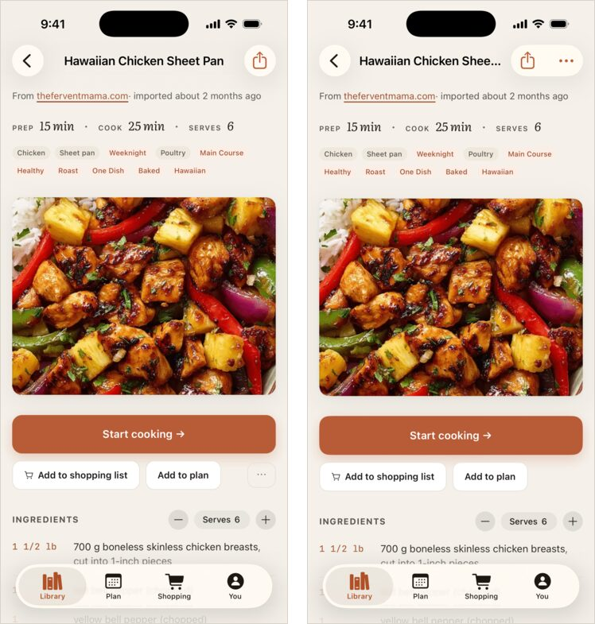

# Vernacular

You shipped a Rails app with a Hotwire Native iOS shell. Now you want a fully native SwiftUI app. Vernacular builds it one screen at a time with nobody at the keyboard, while your Hotwire Native app keeps shipping. Claude Code plans each screen and implements it in small checkpoints. A checkpoint is committed only after every machine gate passes.

Your Rails views are the spec. Each screen state is rendered twice: once by WebKit at iPhone size with the Hotwire Native user agent, exactly as your shell shows it, and once by the SwiftUI app in the simulator, fed the same data. A reviewer compares the two screenshots, and the checkpoint doesn't ship until they match.

It's an open-source take on Shopify's [Helix](https://shopify.engineering/helix), which proved the core idea: **an attempt may be wrong; it may not ship until it isn't.** Vernacular removes the engineer approval gate. Machines enforce every gate, and a checkpoint that can't pass them gets set aside rather than waved through.

## Example

[Prep Slate](https://prepslate.com)'s Hotwire Native iOS app (left) and the fully native SwiftUI app built from it (right) by the loop Vernacular was extracted from. Both show the same library on iOS 26.




## How the migration works

- **The Hotwire Native app stays put.** The SwiftUI app grows beside it (for example in `ios/`), so you can keep releasing the shell until the native app covers every screen.
- **Rails grows a JSON API.** Your HTML controllers keep serving the shell. The native app talks to Rails through API endpoints (for example `/api/v1`), and each checkpoint adds the ones its screen needs, with request specs.
- **Screens move in queue order.** `vernacular/queue.yml` lists your screens (sign in, the index, the detail page, the forms) with the Slim or ERB views, controllers, and Stimulus code each one comes from.
- **Scenarios give both sides the same data.** A scenario seeds one data set with FactoryBot and names the states to show from it. The reference capture screenshots each state in Rails and records the API responses the native screen needs as JSON fixtures. The SwiftUI app launches with `-vernacularScenario <name> -vernacularRoute <path>`, loads those fixtures instead of the network, and renders the same rows, ids, and clock.
- **Native controls win.** Where iOS has a built-in control that does a web control's job better (a `<select>` as a `Picker`, a confirm modal as a `confirmationDialog`), the plan names the substitution and the UI reviewer compares only its text and glyph.

## Requirements

Ruby 3.4+, git, the [`claude`](https://docs.claude.com/en/docs/claude-code) CLI signed in, and Xcode with an iOS simulator. Rails needs Playwright (`capybara-playwright-driver`) for the reference screenshots.

Your test suite must pass on a clean checkout before a run: credential keys in place (`config/credentials/test.key` if you use Active Record encryption) and the test database prepared. `vernacular run` runs the regression commands on HEAD first and refuses to start if they fail, because no checkpoint could fix a broken environment.

## Install

```bash
git clone https://github.com/mark-kraemer/vernacular && cd vernacular
gem build vernacular.gemspec && gem install vernacular-*.gem
```

## Set up a Rails + Hotwire Native app

[examples/rails-to-swiftui](examples/rails-to-swiftui) is a complete setup. From your Rails root, with `EXAMPLE` pointing at that folder in your Vernacular clone:

```bash
vernacular init
cp $EXAMPLE/config.yml vernacular/config.yml
mkdir -p spec/vernacular/scenarios
cp $EXAMPLE/scenario.rb $EXAMPLE/capture_spec.rb spec/vernacular/
cp $EXAMPLE/capture-target bin/capture-target
```

Then:

1. **`spec/vernacular/capture_spec.rb`** needs two helpers from your app: `sign_in_as(user)` for the web session, and `fixture_headers(user)` for the `Authorization` header the native app sends. Set `VERNACULAR_USER_AGENT` to your shell's user agent so `hotwire_native_app?` branches render as they do on device.
2. **`bin/capture-target`** builds the SwiftUI app and screenshots each state. Set `VERNACULAR_XCODEPROJ`, `VERNACULAR_SCHEME`, `VERNACULAR_BUNDLE_ID`, and `VERNACULAR_SIMULATOR`.
3. **The SwiftUI app** honors `-vernacularScenario` and `-vernacularRoute`: when present, it loads `Fixtures/<scenario>.json` instead of the network and opens that route.
4. **`vernacular/config.yml`** names your architecture doc and design system for the reviewers, and the swift and rspec commands for the gates.
5. **`vernacular/queue.yml`** lists your screens in build order.

```bash
git add -A && git commit -m "vernacular setup"
vernacular run               # plan and build every pending screen, unattended
vernacular status            # what's running, the queue, ledgers to read
vernacular pause             # stop cleanly after the current checkpoint
```

Run a single screen with `vernacular run <screen>`. Run only its planning step with `vernacular plan <screen>`. `vernacular capture <scenario>` renders the Rails side and `vernacular shoot <scenario>` renders the SwiftUI side, so you (and the implementer) can compare them by hand.

## The loop

```
plan ──► for each checkpoint:
           implement ─► build ─► behavior ─► UI ─► adversarial ─► (UI again if pixels changed) ─► regression ─► commit
               ▲           │         │        │          │                                          │
               └───────────┴─────────┴────────┴──────────┴─────────── findings ──────────────────────┘
```

- **plan.** A planner reads the screen's views and controllers and writes `vernacular/screens/<screen>/plan.yml` plus its scenarios. Each checkpoint lists a goal, the screen states to compare, and the Swift Testing functions that must pass. The driver checks the plan's shape and proves every state renders in Rails before any code is written.
- **build.** Rubocop on changed Ruby, the project's checks, `swift build`, and `xcodebuild`.
- **behavior.** `swift test` and the API request specs. Every planned test must appear as passed in the output.
- **UI.** Rails and the simulator screenshot each state, and a fresh reviewer compares each pair within the checkpoint's scope. Shell chrome (status bar, navigation bar, tab bar) exists only on the native side and is expected.
- **adversarial.** Fresh, read-only reviewers check the diff against your architecture doc and design system and return structured findings. Every finding must be fixed.
- **regression.** The full `swift test` plus your Rails request and model specs, so a new API endpoint can't break the web app.
- **Memory and checks.** After each commit, a curator folds the round's findings into `memory.md`. An improver turns findings a regex can catch into `checks/*.yml`, which the build gate runs from then on.

Each fix round resumes the implementer's session. Reviewers never share context with it or with each other. Gates read exit codes and schema-constrained JSON, so the model never decides whether a gate passed.

## Config

`vernacular/config.yml`. [templates/config.yml](templates/config.yml) documents every key.

| Key | What it does |
|---|---|
| `reference`, `target` | One line each, used in every prompt (e.g. "the Rails app as its Hotwire Native shell renders it", "a SwiftUI app in ios/") |
| `read_first`, `hard_limits`, `planning` | What the agents read and must not do (e.g. never change web views or the shipping shell) |
| `scenarios` | Where the planner writes a screen's scenarios |
| `commands.lint/build/test/regression` | The gates |
| `commands.test_passed` | Regex proving a named test passed (`{name}` is substituted; `Test {name}\(.*?\) passed` for Swift Testing) |
| `commands.capture_reference/capture_target` | Write `$VERNACULAR_OUTPUT/<scenario>/<state>.png` |
| `reviewers` | Name → docs to enforce + focus. Edits to those docs are logged to `decisions.md` |
| `visible` | Paths whose change re-runs the UI gate |
| `tools` | Extra Claude Code permissions for the implementer (`swift test`, `xcodebuild`, `bundle exec rspec`) |
| `ui_expected` | Differences the UI reviewer should accept, such as chrome only the native side draws |

To override a prompt, put a file of the same name in `vernacular/prompts/` (for example `architecture_reviewer.md`). [prompts/](prompts) has the defaults.

The loop itself knows nothing about Rails or Swift; every stack detail lives in config and your capture commands. Other reference/target pairs work the same way, but Rails + Hotwire Native → SwiftUI is the one the example covers and the one it was built on.

## Guardrails

- The implementer works from a tool allowlist. It can't commit, push, reset, stash, delete files, browse the web, or spawn agents. Reviewers are read-only.
- A run starts only on a clean tree whose regression gate passes.
- After `max_rounds`, the checkpoint's work is stashed (`vernacular blocked <screen>/<checkpoint>`), the screen is marked blocked, and the run moves on to the next screen.
- The improver can only add checks, and each new check must match nothing already in the tree. Checks are read from HEAD, so the implementer can't loosen one.
- Only one run at a time. Vernacular never pushes or opens PRs; a human reviews the branch.

## Files

`vernacular/` is committed: config, queue, memory, plans, checks, `evidence/<screen>/<checkpoint>/` (every gate verdict and review), `decisions.md`, and `improvements.md`. `tmp/vernacular/` holds screenshots, logs, and per-round findings.

## License

MIT
